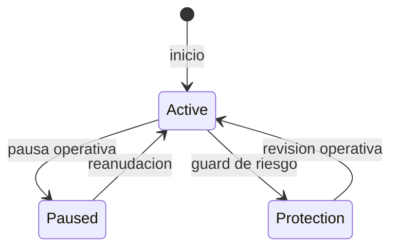

# Arquitectura de SentinelDTL

SentinelDTL separa control operativo, admision de ordenes, sesiones,
liquidacion de unidades de riesgo, vault y observabilidad. La API C publica
esta en `include/sentinel/`; la CLI es un adaptador de escenarios
deterministas sobre esa API.

| Modulo | Responsabilidad | Estado o resultado |
| --- | --- | --- |
| `policy` | Limites por sesion, orden y cola | Parametros y validacion |
| `session` | Apertura, pausa, proteccion, contadores | Estado de sesion |
| `order` | Ciclo de cada orden | ID, unidades y estado |
| `vault` | Reservas y unidades emitidas | Precio de unidad, floor y bloqueos |
| `engine` | Coordinacion de mutaciones | Cuentas, sesiones, ordenes y eventos |
| `risk` | Agregados de seguridad | Snapshot e invariantes |
| `analytics` | Capacidad y sensibilidad | Envelope de solo lectura |
| `json` | Contrato de salida | Snapshot estable para integraciones |

Una pausa bloquea admision y ejecucion. El modo de proteccion bloquea nueva
admision y conserva la politica configurada para procesar trabajo en cola.
El motor registra cada transicion relevante en el log de eventos, con version
de vault, importe y marca de reloj determinista.

## Frontera de integracion

La biblioteca no autentica usuarios ni persiste estado. La capa integradora
debe asignar identidades a cuentas, serializar operaciones y custodiar sus
propias credenciales. El JSON de la CLI no constituye una interfaz de
escritura. No se presupone una red publica ni una base de datos externa.

## Versionado

Cada orden conserva la version del vault en admision y ejecucion. El vault
incrementa version al cambiar reservas o parametros economicos. Esto permite
reconstruir el contexto de una orden a partir del snapshot y la secuencia de
eventos sin depender de logs externos.
