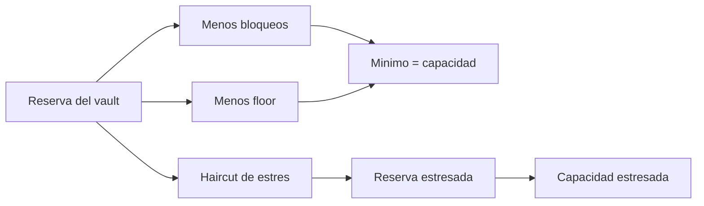

# Modelo economico y capacidad

Los importes de caja y unidades de riesgo son enteros de 64 bits sin signo.
Las comisiones y escenarios de estres usan puntos basicos (`10_000` = 100 %).
La biblioteca comprueba overflow en multiplicaciones y adiciones antes de
actualizar estado.

## Valor de unidad y redencion

```text
valor_unitario = floor(reserva_cash / unidades_emitidas)
salida_bruta = floor(unidades_redimidas × reserva_cash / unidades_emitidas)
comision = floor(salida_bruta × fee_bps / 10_000)
salida_neta = salida_bruta - comision
```

El motor tambien aplica haircut configurado y exige que el floor de reserva
permanezca cubierto. Los tests de ejemplo usan `900_000` de reserva y `9_000`
unidades, de modo que el valor inicial es `100` unidades de caja por unidad
de riesgo. Una orden de `400` unidades tiene salida bruta inicial de `40_000`
antes de comision y de cualquier cambio posterior del vault.

## Capacidad operativa

`sg_liquidity_envelope_from_vault` calcula una vista de lectura:

```text
liquido = max(0, reserva_cash - caja_bloqueada)
headroom = max(0, reserva_cash - floor)
capacidad = min(liquido, headroom)
perdida_estres = floor(reserva_cash × stress_bps / 10_000)
reserva_estresada = reserva_cash - perdida_estres
capacidad_estresada = min(
  max(0, reserva_estresada - caja_bloqueada),
  max(0, reserva_estresada - floor)
)
```

Ejemplo: reserva `900_000`, floor `250_000`, caja bloqueada `100_000`.
Liquido `800_000`; headroom `650_000`; capacidad `650_000`. Con estres
del 10 %, la reserva pasa a `810_000` y la capacidad a `560_000`.



La sensibilidad no predice precios, no autoriza retiros y no sustituye la
comprobacion de estado de cada orden. Es una medida de holgura del vault
para operaciones y control de riesgo.
