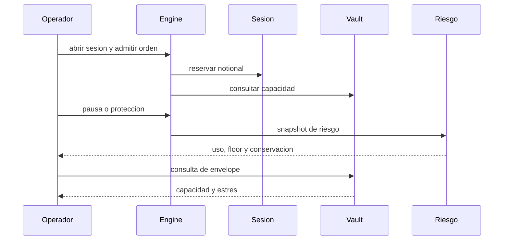

# Operacion y seguridad activa

SentinelDTL distingue tres modos del plano de control: activo, pausado y
proteccion. La capa operadora debe registrar motivo y hora de cada cambio,
revisar la cola pendiente y comprobar snapshots de riesgo antes y despues.



## Rutina previa a una ventana

1. Verificar politica: limite de sesion, cola, orden, floor y comision.
2. Comparar caja de cuentas y reserva con el total esperado.
3. Confirmar unidades emitidas frente a unidades distribuidas.
4. Inspeccionar ordenes vivas, importe admitido y version de vault.
5. Calcular capacidad base y estresada; elevar alerta si el floor no queda
   cubierto en el escenario aprobado.

## Indicadores

| Indicador | Interpretacion |
| --- | --- |
| `queue_utilization_bps` | Porcentaje de capacidad de cola ocupado |
| `session_utilization_bps` | Uso de limites de sesion agregados |
| `reserve_floor_bps` | Floor relativo a reserva actual |
| `cash_conservation` | Reconciliacion de caja |
| `unit_conservation` | Reconciliacion de unidades |
| `stressed_redeem_capacity` | Holgura del vault tras estres parametrizado |

Un valor de `balanced=true` confirma las invariantes incluidas en el
snapshot; no reemplaza una revision completa de todas las transiciones de
sesion. Para investigar un incidente, conserve commit, entrada, JSON,
eventos y parametros del vault, sin adjuntar secretos o datos de clientes.

## Validacion de version estable

```bash
bash scripts/ci.sh
```

CI compila con advertencias como errores, ejecuta dos casos C de capacidad,
valida sintaxis JavaScript, ejecuta tests Node y recorre la CLI. El workflow
de integridad exige que `main`, `production` y el tag anotado `v1.0.0`
apunten al mismo commit. El release identifica codigo, no un despliegue
automatico en una red externa.
